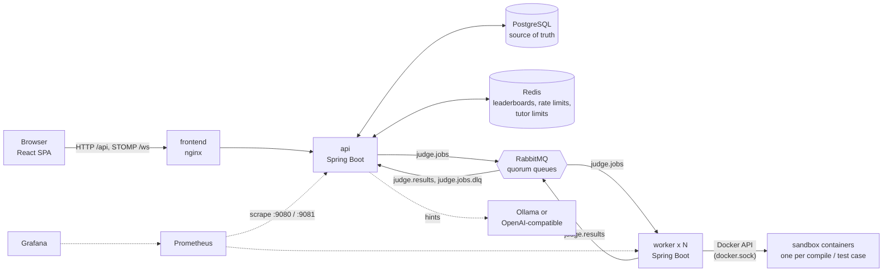
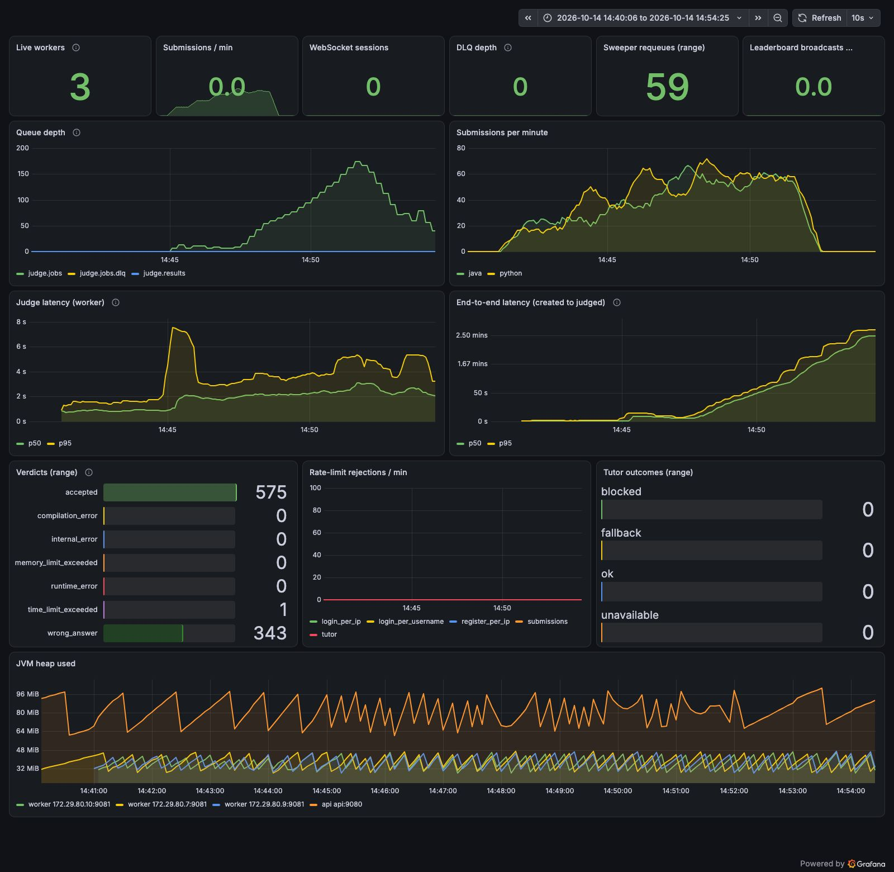
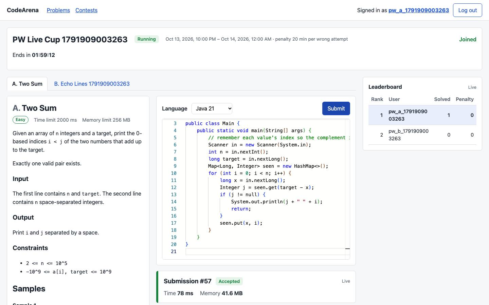
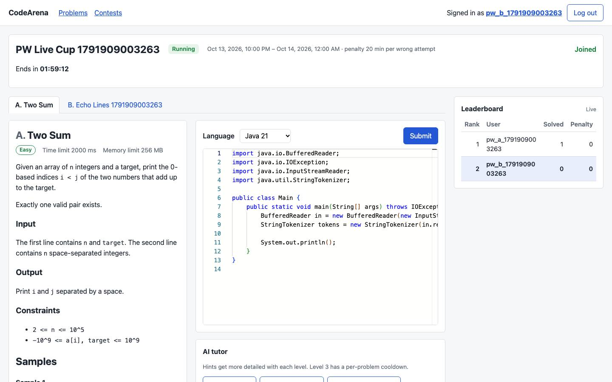
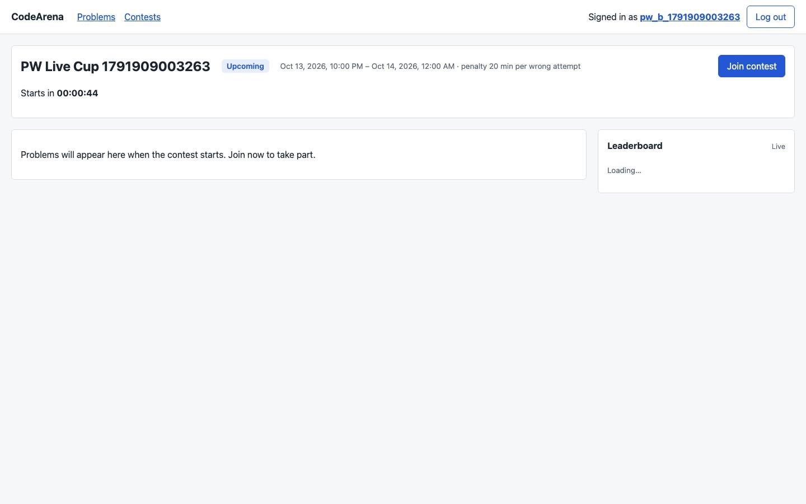
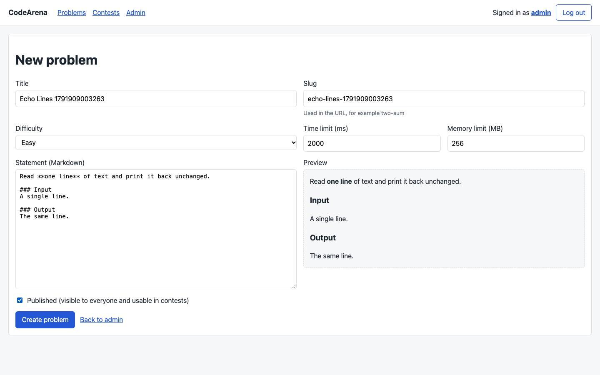
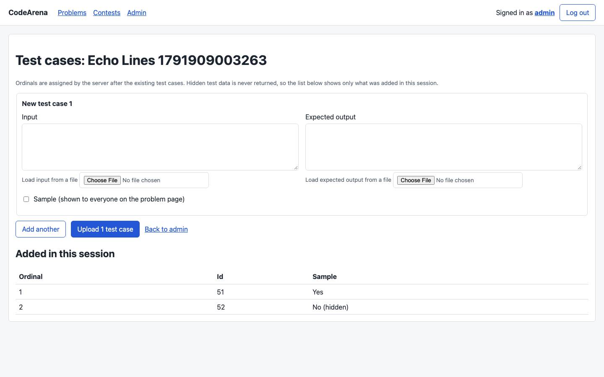
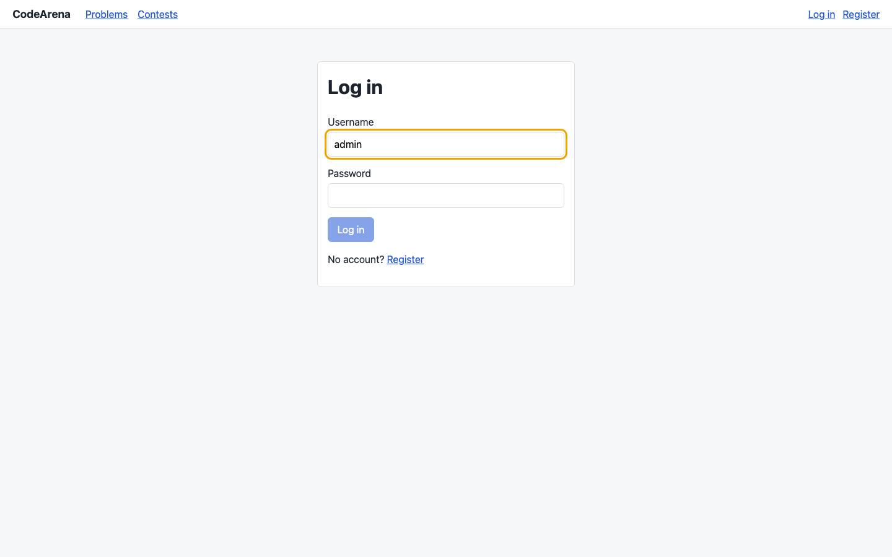
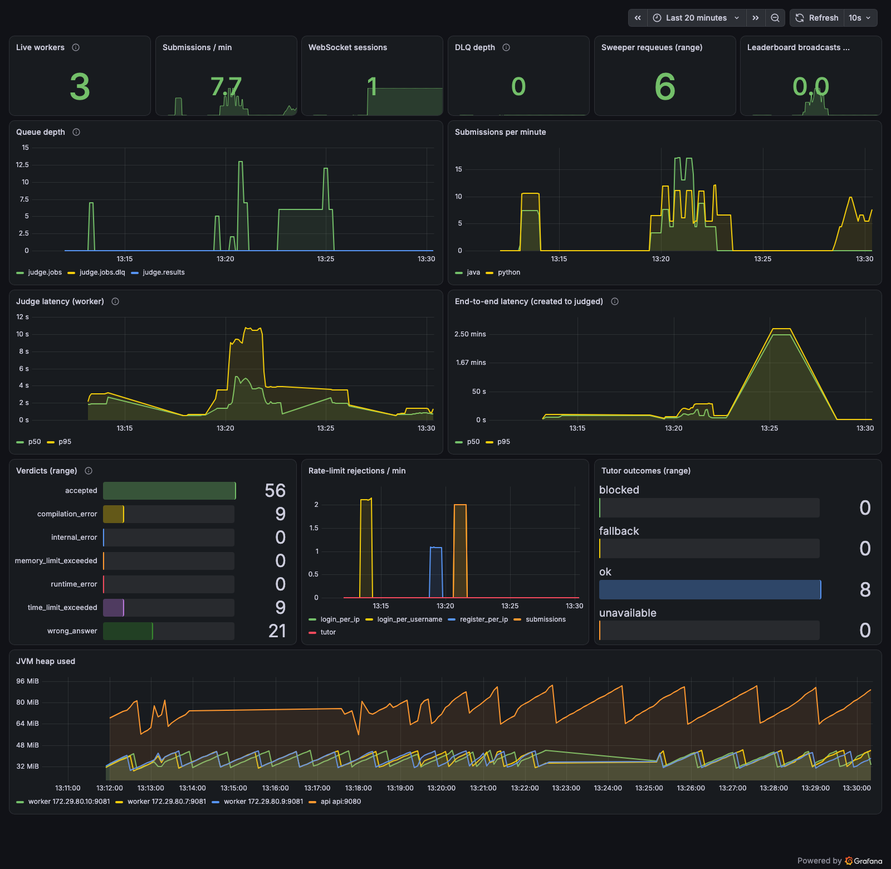

# CodeArena

A LeetCode/Codeforces-style judge with a sandboxed execution engine, queue-based workers, real-time contests, and an
AI tutor that teaches instead of solving.

Users solve programming problems in a browser editor; their Java or Python code runs in locked-down Docker
containers and comes back with a verdict over a WebSocket. Admins run timed ICPC-style contests with a live
leaderboard. The tutor gives graded hints and explains failed submissions without handing out the solution.

Solo project: Spring Boot 3.5 (Java 21), RabbitMQ, PostgreSQL, Redis, React + TypeScript, Docker Compose.

## Features

- **Sandboxed judging** of Java 21 and Python 3.12: one fresh container per compile and per test case, with no
  network, memory/CPU/pids limits, a read-only root filesystem, a non-root user, dropped capabilities, an output cap
  and a wall-clock kill. Verdicts: Accepted, Wrong Answer, Time Limit Exceeded, Memory Limit Exceeded, Runtime
  Error, Compilation Error, Internal Error.
- **Asynchronous pipeline**: the api saves a submission as PENDING and publishes a job; a pool of stateless
  workers judges it and publishes the result; the api applies it exactly once. Manual acks, a delivery limit with a
  dead-letter queue, and a sweeper for stuck submissions.
- **Live updates** over STOMP WebSockets: submission status and contest leaderboards.
- **Contests**: ICPC scoring (solved, then penalty minutes), Redis sorted-set leaderboard derived from the
  database, join and submit windows enforced server-side.
- **AI tutor** (Spring AI): hint levels 1 to 3 and failure explanations, a code-block guardrail with one stricter
  retry, level-3 cooldown and a daily cap; Ollama locally or an OpenAI-compatible endpoint by configuration. Blocked
  for problems in a running contest.
- **Hardening**: Bucket4j rate limits in Redis that fail closed, request size limits, one error format, JWT auth
  with roles.
- **Observability**: Micrometer metrics (queue depth, judge and end-to-end latency histograms, verdicts,
  rate-limit rejections, tutor outcomes, WebSocket sessions) scraped by Prometheus, with a provisioned Grafana
  dashboard.
- **Frontend**: React + Vite + TypeScript, Monaco editor, live verdict panel, contest pages, minimal admin pages.
- **30 problems**: 6 seeded plus 24 original problem packs (10 Easy, 10 Medium, 4 Hard) whose tests are generated
  from seeds and cross-checked against a brute force and a second-language reference before import, then verified
  through the live judge. See [docs/PROBLEMS.md](docs/PROBLEMS.md).

## Architecture



### Judging flow

1. `POST /api/submissions` validates the request, applies the per-user rate limit, saves the submission as
   PENDING and returns its id. After the transaction commits, the api publishes a `JudgeJob` (source, limits and
   test cases) to `judge.jobs` and waits for the broker's confirm.
2. The browser subscribes to `/topic/submissions/{id}`.
3. A worker takes the job (prefetch 1, manual ack), publishes RUNNING, compiles in a sandbox if needed, then runs
   each test case in a fresh container and compares the output (trailing whitespace per line and trailing blank
   lines ignored), stopping at the first failure.
4. The worker publishes a `JudgeResult` to `judge.results` and acks the job only after the broker confirms the
   result. A judge-side error is nacked; after 3 deliveries the job goes to `judge.jobs.dlq` and the api marks the
   submission INTERNAL_ERROR.
5. The api applies the result with a conditional update (only from PENDING or RUNNING), then updates the contest
   leaderboard and pushes the new status over WebSocket.
6. A sweeper re-publishes submissions stuck in PENDING or RUNNING for over 2 minutes, at most 3 times.

## Quick start

Requirements: Docker with the Compose plugin and buildx, and cgroup v2 on the Docker host. Verified on macOS with
Colima only; a plain Linux Docker host should work (the differences are noted in `docs/DESIGN.md` section 15) but has not
been tested. On Colima the repo must be under your home directory, because Colima shares only `$HOME` with its VM.

```sh
git clone <repo-url> codearena && cd codearena
cp .env.example .env
```

Edit `.env`:

- Replace every `change-me` value, including `GRAFANA_ADMIN_PASSWORD`.
- Set `DOCKER_SOCKET_GID` to the group that owns the Docker socket as the daemon sees it:
  - Colima: `colima ssh -- stat -c %g /var/run/docker.sock`
  - Linux: `stat -c %g /var/run/docker.sock`
  - Any daemon: `docker run --rm -v /var/run/docker.sock:/s alpine stat -c %g /s`

Compose refuses to start and names the variable if a required value is missing. Then:

```sh
docker compose --profile judge-images build judge-java judge-python
docker compose up -d --build --scale worker=3
docker compose ps
```

| What | Where |
|---|---|
| App | http://localhost:8080 (log in with `ADMIN_USERNAME` / `ADMIN_PASSWORD`) |
| Grafana | http://127.0.0.1:3000 (`admin` / `GRAFANA_ADMIN_PASSWORD`), dashboard "CodeArena overview" |
| Prometheus | http://127.0.0.1:9090 |

The database starts with the 6 seeded problems. To add the 24 problem packs (Python 3.12 needed):
`python3.12 tools/problems/import.py --env-file .env`.

Optional demo data (a contest and three users, with passwords printed once):
`python3 scripts/demo-seed.py`. The demo script is in [docs/DEMO.md](docs/DEMO.md).

The tutor uses Ollama on the host (`OLLAMA_BASE_URL=http://host.docker.internal:11434`, model `qwen2.5-coder:1.5b`)
by default. Without a reachable model, or with `AI_CHAT_PROVIDER=openai` and no key, the tutor answers 503 and
everything else works.

### Host-run development

Run the infrastructure in Compose with its ports on 127.0.0.1, and the apps on the host:

```sh
docker compose -f docker-compose.yml -f docker-compose.dev.yml up -d postgres redis rabbitmq
./judge-images/build.sh
set -a; . ./.env; set +a
export OLLAMA_BASE_URL=http://localhost:11434
export DOCKER_HOST="unix://$HOME/.colima/default/docker.sock"   # Colima only
mvn -pl api -am spring-boot:run      # http://localhost:8080
mvn -pl worker -am spring-boot:run   # second terminal
cd frontend && npm ci && npm run dev # http://localhost:5173 (set CORS_ALLOWED_ORIGINS=http://localhost:5173)
```

### Build and tests

```sh
CI_REQUIRE_DOCKER=true mvn -B clean verify
cd frontend && npm ci && npm run lint && npm run typecheck && npm test && npm run build
```

`CI_REQUIRE_DOCKER=true` turns every "Docker or judge image missing" skip into a failure. On Colima also export
`DOCKER_HOST="unix://$HOME/.colima/default/docker.sock"` and `TESTCONTAINERS_DOCKER_SOCKET_OVERRIDE=/var/run/docker.sock`.
On 2026-10-14 this ran 397 backend tests (0 skipped) and 80 frontend tests on this machine, all passing.

**CI status:** `.github/workflows/ci.yml` builds the judge images, runs the full backend build with
`CI_REQUIRE_DOCKER=true` and the frontend checks. It passes actionlint, but **it has never run on GitHub**: the
repository has not been pushed.

## Sandbox security

Applied by `ContainerExecutor` through docker-java, per container:

| Limit | Setting | Proven by |
|---|---|---|
| No network | `--network none` | `SandboxAbuseTest.outboundNetworkIsBlocked` (Java and Python) |
| Memory | problem limit (+64 MB JVM overhead for Java), swap disabled (`memory-swap = memory`) | `SandboxAbuseTest.memoryHogIsReportedAsOom` |
| Processes | `pids-limit 64` | `processSpawningIsCappedByPidsLimit`, `forkBombIsContainedAndWorkerSurvives` |
| Time | wall-clock kill at the time limit + 1 s grace; container wall time compared with the limit | `infiniteLoopIsKilledAsTimeout` |
| Filesystem | read-only root filesystem, 16 MB `noexec` tmpfs at `/tmp`, inputs in a root-owned read-only volume | `onlyTmpfsIsWritable` |
| Output | 1 MiB per stream, container killed at once when exceeded, Docker logging off | `hugeStdoutIsTruncatedAndKilled` |
| Isolation between runs | fresh container and fresh input volume per run, nothing shared on disk | `filesDoNotLeakBetweenRuns` |
| CPU | 1 CPU (`nano-cpus`) | configured; no dedicated test |
| Privileges | user 10001, all capabilities dropped, `no-new-privileges` | configured; no dedicated test |
| Source handling | copied in with `copyArchiveToContainer`, never placed in a shell string | by construction (`TarArchives`) |

Run in the real stack for the demo (Python, Fibonacci problem, 2026-10-14): an infinite loop came back
TIME_LIMIT_EXCEEDED, a 1 GiB allocation MEMORY_LIMIT_EXCEEDED, a fork bomb, an outbound HTTP call and a write
outside `/tmp` RUNTIME_ERROR, and no sandbox container was left behind.

**The Docker socket trade-off.** The worker mounts `/var/run/docker.sock` to start sandboxes, and access to that
socket is equivalent to root on the Docker host. User code never sees it (sandboxes have no socket and no network),
but a code-execution bug in the worker would own the host. Mitigations: only the worker has the socket, it
publishes no ports and only consumes `judge.jobs`, runs as non-root with a read-only filesystem and no
capabilities, and deserializes only the shared record types. In production: run sandboxes under **gVisor**, in
**Firecracker** microVMs, or on **dedicated judge hosts** that hold no data. Details in
[judge-images/README.md](judge-images/README.md); running on a VM is in [docs/DEPLOY.md](docs/DEPLOY.md).

## Design decisions and trade-offs

- **Queue topology.** Three durable quorum queues (`judge.jobs`, `judge.results`, `judge.jobs.dlq`) declared
  identically by both services from `JudgeQueues` in the shared module. A quorum queue dead-letters after its
  delivery limit, and on RabbitMQ 3.13 a limit of N allows N + 1 deliveries: 3 attempts need
  `x-delivery-limit: 2`, which was found by testing, not from the docs.
- **Exactly-once result handling.** Delivery is at least once; the effect is exactly once. The api moves a
  submission to RUNNING only from PENDING, and to a final verdict only from PENDING or RUNNING; a result that
  updates zero rows is ignored. The worker has no database, so a redelivered job may be judged again, and that is
  safe. Measured in the saturation test: 59 jobs judged twice, 59 second results ignored, no double counting.
- **Verdicts are counted in the api, not the worker.** Because the worker can judge a job twice, the verdict
  counter and end-to-end latency are recorded only when the api's conditional update actually finalizes a
  submission, after the transaction commits. The load tests check that the Prometheus counters equal the database
  counts after every run.
- **Leaderboard as derived data.** Postgres is the source of truth; Redis holds a sorted set per contest with score
  `solved * 10,000,000 - penaltyMinutes`, so one `ZREVRANGE` gives ICPC order. After each result the user's score is
  recomputed from the database and written with `ZADD` (recompute, never increment, so redelivered or reordered
  results cannot drift it); a missing key is rebuilt atomically; if Redis is down, reads compute the ranking from the
  database. Broadcasts are coalesced to at most one per second per contest.
- **AI guardrails.** The prompt forbids solution code; a post-check rejects any fenced code block over 10 lines (none
  at levels 1 and 2), retries once with a stricter prompt, then returns a fixed fallback. Hidden test data never
  enters a prompt. What it cannot catch: a full solution described in prose, unfenced or inline code, pseudocode as
  a numbered list, or simply wrong advice.
- **Rate limiting fails closed.** Buckets live in Redis so all api instances share them; if Redis is unreachable,
  limited endpoints answer 503 instead of letting traffic through unlimited.
- **Single-instance WebSocket broker.** STOMP uses Spring's in-memory broker, so updates reach only sockets on the
  same api instance. Compose runs one api; scaling it needs a shared broker (RabbitMQ's STOMP relay or Redis
  pub/sub).
- **Never log user code or hidden data.** Message bodies are excluded from AMQP log lines, results carry only
  compiler output or fixed strings, and the tutor logs only ids, lengths and timings.

The full decisions log is section 15 of [docs/DESIGN.md](docs/DESIGN.md).

## Load test results

Measured with k6 on 2026-10-14 on this machine: Mac17,5 (Apple A18 Pro, 6 cores, 8 GB RAM) on AC power, Colima
4 vCPU / 6 GiB running the whole stack and the sandboxes, rate limits raised except in the last row, other Docker
workloads stopped. Details, caveats and raw k6 summaries are in [loadtest/](loadtest/README.md).

| Run | Judged/min | Time to verdict p50 / p95 (k6) | Judge p50 / p95 |
|---|---|---|---|
| 1 worker, 6 VUs closed model | 66.3 | 4,343 / 5,854 ms | 878 / 1,573 ms |
| 3 workers, 6 VUs closed model | 90.3 | 2,888 / 4,604 ms | 1,938 / 3,244 ms |
| 3 workers, 100/min offered (open model) | 97.5 | 7,075 / 10,190 ms | 1,890 / 3,034 ms |
| 3 workers, 130/min offered (rerun) | 78.5 (queue grows) | 21,077 / 60,271 ms | 2,079 / 4,205 ms |
| 50 WebSocket clients + 4 submitters | all 5,000 boards delivered | broadcast to receipt p50 20 ms, p95 58 ms | |
| Real limits, 2 users scripting submits | 19 accepted in 1 min | 35,097 answered 429 | |

Caveats:

- **Scaling is far from linear here**: 3 workers gave 1.36x the throughput of 1. Everything shares 4 vCPUs, and the
  bottleneck is the container lifecycle: with 3 workers busy, only 0.8 sandboxes were running on average while
  `dockerd` and `containerd` used about 75% of a core.
- **Saturation is about 100 submissions/min** with 3 workers; above it the queue grows and throughput settles at
  about 80/min.
- Run-to-run variance: an earlier identical pair measured 50.7 and 76.3 judged/min.
- Findings, not yet fixed: a correct solution was once judged TIME_LIMIT_EXCEEDED under contention (wall-clock
  limit), the sweeper re-publishes jobs that are merely queued during a long backlog, and nginx ran out of upstream
  ports at about 560 requests/s. See [loadtest/README.md](loadtest/README.md).



## Screenshots

| | |
|---|---|
|  |  |
|  |  |
|  |  |



## Limitations

Honest list, from section 16 of [docs/DESIGN.md](docs/DESIGN.md):

- **Tutor quality with the local model is weak.** `qwen2.5-coder:1.5b` (the largest coding model that fits an 8 GB
  machine next to Docker) is fast but often wrong: one level 2 hint for Two Sum suggested sorting, which loses the
  original indices, and one explanation fell into a repetition loop. A hosted model is needed for a good demo.
- **The hosted-provider path was only verified against a local fake OpenAI-compatible server**, never against a
  real hosted model.
- **CI has never run on GitHub.**
- **Not deployed.** The default way to show the project is a recorded demo; a single-VM setup is documented in
  [docs/DEPLOY.md](docs/DEPLOY.md) with its risks.
- The guardrail cannot catch solutions described in prose, inline or unfenced code, or wrong advice.
- One api instance: the WebSocket broker is in memory.
- The time limit is wall-clock, so heavy contention can turn a correct solution into a TLE (seen once in the load
  test); the sweeper cannot tell a queued job from a lost one under a long backlog; nginx does not keep upstream
  connections alive.
- No refresh tokens (log in again after 2 hours), no custom-input runs, no problem search, no admin read
  endpoints (an unpublished problem cannot be reopened for editing), no server time for contest countdowns,
  leaderboard shows the top 50 only.
- Per-IP limits behind Colima see one address for every browser on the machine.
- Languages: Java and Python only.

## Documentation

- [docs/DESIGN.md](docs/DESIGN.md): design, build phases, decisions log, open questions
- [docs/DEMO.md](docs/DEMO.md): 4 to 5 minute demo script
- [docs/DEPLOY.md](docs/DEPLOY.md): single-VM setup and firewall checklist
- [docs/INTERVIEW.md](docs/INTERVIEW.md): interview questions answered from this code, and resume bullets
- [docs/PROBLEMS.md](docs/PROBLEMS.md): the problem list, pack format and problem tooling
- [docs/websocket.md](docs/websocket.md): STOMP destinations and frames
- [judge-images/README.md](judge-images/README.md): judge images, Docker host setup, docker.sock trade-off
- [loadtest/README.md](loadtest/README.md): load tests and results

## License

MIT, see [LICENSE](LICENSE).
