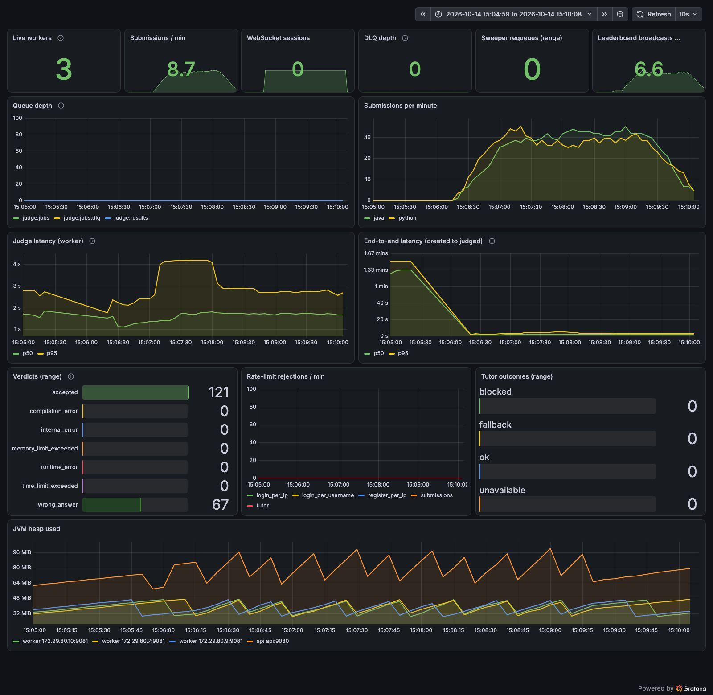

# Leaderboard fan-out: 50 STOMP clients, 4 contest submitters, 3 workers

Run `10140935` (leaderboard-fanout), 2026-10-14 09:36:00 UTC to 2026-10-14 09:39:46 UTC.

## Run conditions

- SentinelAI stopped, Colima 4 CPU / 6 GiB, on AC power.
- Host: Mac17,5 (Apple A18 Pro, 6 cores, 8 GB RAM), macOS, Colima 0.10.3 (vz), Docker 29.
- Workers: 3 (`WORKER_CONCURRENCY=1`, prefetch 1), api x1, everything in Docker Compose on the same VM as the sandboxes.
- **Rate limits raised** with `docker-compose.loadtest.yml` (all api limits set to 100000); k6 runs from one client IP and a few dozen users, so the real limits would block it.
- k6 v2.3.0 on the host, against the frontend container (`http://localhost:8080`). Scenario: 50 WebSocket clients (k6/websockets, STOMP 1.2, no heart-beats) connect through nginx and subscribe to /topic/contests/{id}/leaderboard, staying connected for 225 s; from 15 s, 4 VUs submit contest solutions (same 8-solution mix) for 180 s with 2 s think time after each verdict; 20 users, all joined to a fresh contest; the 50 clients share those 20 users' tokens.
- Time to verdict is measured by k6 from just before `POST /api/submissions` until a `GET /api/submissions/{id}` poll (every 250 ms) sees a final status, so it includes up to 250 ms of polling granularity.

## k6

| Metric | Value |
|---|---|
| Submissions accepted by the api (201) | 185 |
| Submissions rejected | 0 |
| Submit success rate | 100.00% |
| HTTP requests (incl. polls) / failed rate | 1745 / 0.00% |
| Verdict timeouts (no final status within 10 min) | 0 |
| Verdict differed from the solution's expected verdict | 0 |
| Submit latency p50 / p95 (all) | 23 ms / 70 ms |
| Time to verdict p50 / p95 (all) | 1,857 ms / 3,160 ms |

## Throughput and server-side latency

Created and judged per minute come from `submissions.created_at` / `judged_at` in Postgres for this run's users. Judge and end-to-end percentiles are `histogram_quantile` over the window from the Prometheus histograms (bucket boundaries limit their precision). Queue depth is ready messages in `judge.jobs`, sampled every 15 s.

| Window | Minutes | Created/min | Judged/min | Judge p50 / p95 | End-to-end p50 / p95 | Queue start / end / max |
|---|---|---|---|---|---|---|
| whole run | 3.8 | 49.2 | 49.2 | 1,657 ms / 2,856 ms | 1,755 ms / 3,060 ms | 0 / 0 / 0 |

Queue depth over time (`judge.jobs`, every 30 s from the run start):

```
0s=0 30s=0 60s=0 90s=0 120s=0 150s=0 180s=0 210s=0 240s=0
```

## Resources (mean / max over the run, 45 samples)

VM CPU is the whole Docker VM from `/proc/stat` (4 vCPU = 100%), split into user and system (kernel) time. Process CPU is from `top` inside the VM in % of one core; it misses processes shorter than its 1 s interval, which includes most sandbox runs. Container CPU is `docker stats` (% of one core).

| Measure | Mean | Max |
|---|---|---|
| VM CPU busy | 46% | 79% |
| VM CPU user | 30% | 51% |
| VM CPU system (kernel) | 16% | 28% |
| VM CPU iowait | 2% | 4% |
| Sandbox containers alive | 0 | 2 |
| top: java | 17% | 54% |
| top: python | 1% | 16% |
| top: dockerd | 19% | 41% |
| top: containerd | 25% | 50% |
| top: runc | 0% | 0% |
| top: postgres | 1% | 6% |
| top: rabbitmq | 3% | 32% |
| docker stats CPU: api | 11% | 37% |
| docker stats CPU: worker | 9% | 35% |
| docker stats CPU: postgres | 3% | 9% |
| docker stats CPU: rabbitmq | 7% | 58% |
| memory: api | 544 MiB | 550 MiB |
| memory: worker | 887 MiB | 890 MiB |

## Leaderboard fan-out

Clock offset Docker VM minus host: 94.0 ms (median of 3 round trips; receive times were shifted by it).

| Metric | Value |
|---|---|
| STOMP clients connected | 50 |
| Broadcasts logged by the api | 100 |
| Boards received (all clients) | 5000 |
| Boards per client min / median / max | 100 / 100 / 100 |
| Delivered / expected (broadcasts x clients) | 5000 / 5000 (100.0%) |
| Result applied (`judged_at`) to board received p50 / p95 / max | 827 ms / 1,082 ms / 1,290 ms |
| Broadcast log line to board received p50 / p95 / max | 20 ms / 66 ms / 2,853 ms |

`judged_at` to receipt includes the coalescing window: the api broadcasts a contest's board at most once per `LEADERBOARD_BROADCAST_INTERVAL` (1 s), so up to 1 s of this is by design. Each receipt is matched to the latest result applied (or broadcast logged) before it.

## Correctness checks

| Check | Result |
|---|---|
| Submissions in the database for this run | 185 |
| Still PENDING / RUNNING after drain | 0 |
| INTERNAL_ERROR | 0 |
| Finalized exactly once (one `Submission N judged` api log line each) | 185 of 185 |
| Duplicate results ignored by the api (`already final`) | 0 |
| Submissions judged more than once by workers (extra judgings) | 0 (0) |
| Prometheus verdict counter deltas equal database counts | yes |

Verdicts (database):

| Language | Verdict | Database | Prometheus delta |
|---|---|---|---|
| java | accepted | 49 | 49 |
| java | wrong_answer | 44 | 44 |
| python | accepted | 70 | 70 |
| python | wrong_answer | 22 | 22 |

All checks passed.



## Correction: broadcast-to-receipt latency (re-analysed from the kept k6 console log and api log)

The "Broadcast log line to board received" row above matches each receipt to the latest broadcast log line before
it. The api writes that log line after handing the board to the broker, so a fast receipt can precede its own log
line by a few milliseconds and is then matched to the previous broadcast, about 1 to 3 s earlier. Its max of
2,853 ms is that artifact, not a slow delivery.

Pairing instead each burst of receipts with its own broadcast:

- The api logged 102 broadcasts in the window; the first 2 came from contest joins during setup, before any client
  had subscribed. The other 100 pair one to one with 100 receipt bursts, and **every burst has exactly 50 boards**
  (one per client).
- Broadcast log line to board received, over all 5,000 receipts, shifted by the measured 94 ms clock offset:
  **p50 20 ms, p95 58 ms, max 105 ms** (min -7 ms: the log line is written after the send, and the offset itself is
  only known to a few tens of milliseconds because it is measured with `docker exec`).
- Within one broadcast, the first to the last of the 50 clients received the board within a median of 11 ms, p95 23
  ms, max 38 ms.
- Broadcasts were at least 1,048 ms apart (median 1,622 ms), matching the 1 s coalescing interval.

The `judged_at` to board received row (p50 827 ms, p95 1,082 ms, max 1,290 ms) stands: most of it is the up to 1 s
coalescing delay by design, plus the delivery time above. The run's rows were cleaned up after the checks passed,
so the file was not regenerated; `loadtest/analyze.py` now pairs receipts with broadcasts this way for future runs.
