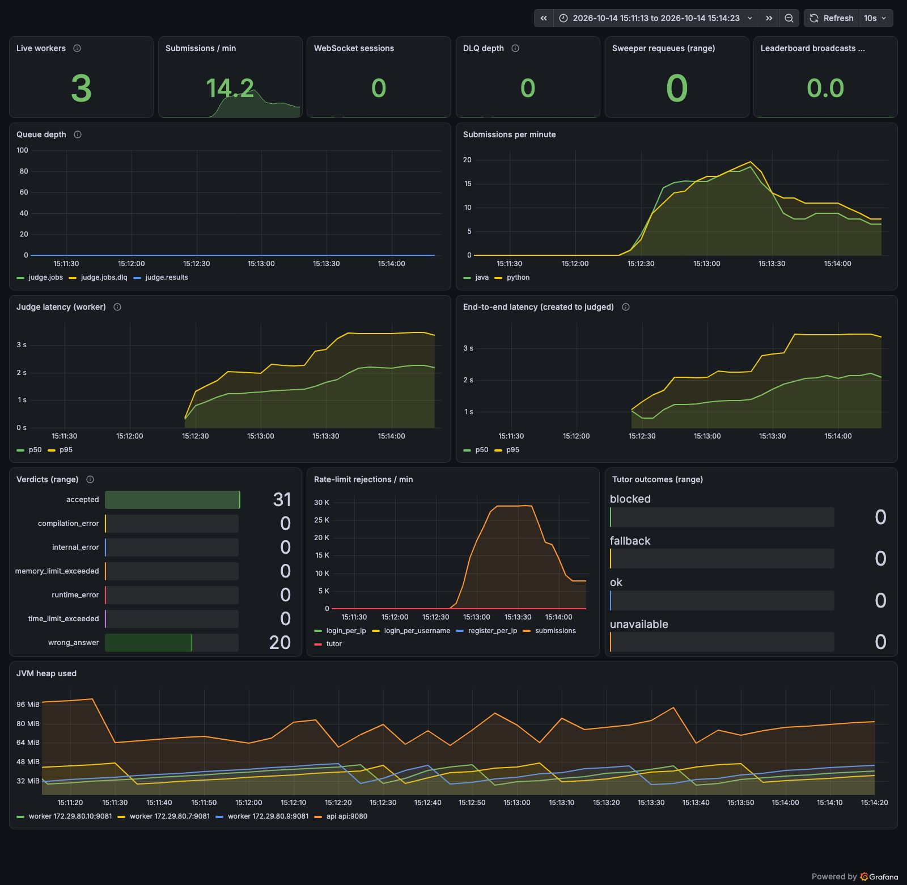

# Real rate limits on: 4 VUs, 2 users, no think time

Run `10140942` (real-limits), 2026-10-14 09:42:14 UTC to 2026-10-14 09:43:55 UTC.

## Run conditions

- SentinelAI stopped, Colima 4 CPU / 6 GiB, on AC power.
- Host: Mac17,5 (Apple A18 Pro, 6 cores, 8 GB RAM), macOS, Colima 0.10.3 (vz), Docker 29.
- Workers: 3 (`WORKER_CONCURRENCY=1`, prefetch 1), api x1, everything in Docker Compose on the same VM as the sandboxes.
- **Real rate limits** (the defaults from `.env.example`: 10 submissions/min per user).
- k6 v2.3.0 on the host, against the frontend container (`http://localhost:8080`). Scenario: ramping VUs 0 to 4 over 30 s (warm-up), 4 VUs for 1 min (steady state), ramp-down 10 s; no think time; 2 users, so 2 VUs share each user's limit of 10 submissions per minute; same 8-solution mix. A rejected submit returns immediately and the VU tries again.
- Time to verdict is measured by k6 from just before `POST /api/submissions` until a `GET /api/submissions/{id}` poll (every 250 ms) sees a final status, so it includes up to 250 ms of polling granularity.

## k6

| Metric | Value |
|---|---|
| Submissions accepted by the api (201) | 50 |
| Submissions rejected | 56236 |
| Submit success rate | 0.09% |
| HTTP requests (incl. polls) / failed rate | 56802 / 99.43% |
| Verdict timeouts (no final status within 10 min) | 0 |
| Verdict differed from the solution's expected verdict | 0 |
| Submit latency p50 / p95 (all) | 3 ms / 7 ms |
| Time to verdict p50 / p95 (all) | 1,828 ms / 6,397 ms |
| Rejected with 429 Too Many Requests | 35097 |

## Throughput and server-side latency

Created and judged per minute come from `submissions.created_at` / `judged_at` in Postgres for this run's users. Judge and end-to-end percentiles are `histogram_quantile` over the window from the Prometheus histograms (bucket boundaries limit their precision). Queue depth is ready messages in `judge.jobs`, sampled every 15 s.

| Window | Minutes | Created/min | Judged/min | Judge p50 / p95 | End-to-end p50 / p95 | Queue start / end / max |
|---|---|---|---|---|---|---|
| steady state | 1.0 | 19.0 | 19.0 | 2,147 ms / 3,418 ms | 2,058 ms / 3,418 ms | 0 / 0 / 0 |
| whole run | 1.7 | 29.7 | 29.7 | 1,506 ms / 2,810 ms | 1,575 ms / 2,828 ms | 0 / 0 / 0 |

Queue depth over time (`judge.jobs`, every 30 s from the run start):

```
0s=0 29s=0 59s=0 89s=0 119s=0
```

## Resources (mean / max over the steady state, 12 samples)

VM CPU is the whole Docker VM from `/proc/stat` (4 vCPU = 100%), split into user and system (kernel) time. Process CPU is from `top` inside the VM in % of one core; it misses processes shorter than its 1 s interval, which includes most sandbox runs. Container CPU is `docker stats` (% of one core).

| Measure | Mean | Max |
|---|---|---|
| VM CPU busy | 69% | 81% |
| VM CPU user | 28% | 60% |
| VM CPU system (kernel) | 40% | 55% |
| VM CPU iowait | 1% | 1% |
| Sandbox containers alive | 0 | 0 |
| top: java | 64% | 241% |
| top: python | 0% | 5% |
| top: dockerd | 16% | 30% |
| top: containerd | 17% | 31% |
| top: runc | 0% | 0% |
| top: postgres | 0% | 2% |
| top: rabbitmq | 5% | 45% |
| docker stats CPU: api | 48% | 181% |
| docker stats CPU: worker | 3% | 9% |
| docker stats CPU: postgres | 3% | 6% |
| docker stats CPU: rabbitmq | 10% | 66% |
| memory: api | 478 MiB | 482 MiB |
| memory: worker | 890 MiB | 890 MiB |

## Correctness checks

| Check | Result |
|---|---|
| Submissions in the database for this run | 50 |
| Still PENDING / RUNNING after drain | 0 |
| INTERNAL_ERROR | 0 |
| Finalized exactly once (one `Submission N judged` api log line each) | 50 of 50 |
| Duplicate results ignored by the api (`already final`) | 0 |
| Submissions judged more than once by workers (extra judgings) | 0 (0) |
| Prometheus verdict counter deltas equal database counts | yes |

Verdicts (database):

| Language | Verdict | Database | Prometheus delta |
|---|---|---|---|
| java | accepted | 8 | 8 |
| java | wrong_answer | 16 | 16 |
| python | accepted | 22 | 22 |
| python | wrong_answer | 4 | 4 |

All checks passed.



## Analysis

- The limiter did its job: with 2 users and a limit of 10 submissions per minute each, 19 submissions were accepted
  in the 1-minute steady state (50 over the 1.7-minute run, which spans parts of three rate-limit minutes) and
  35,097 attempts were answered `429 Too Many Requests`. Every accepted submission was judged and checked
  (see below).
- **Finding: 21,139 attempts got `502 Bad Gateway` from nginx, not 429.** The frontend's nginx error log shows
  `connect() to 172.29.80.8:8080 failed (99: Address not available) while connecting to upstream` at level `crit`
  between 09:43:09 and 09:43:52 UTC. With no think time, a rejected submit returns in about 3 ms and the VU retries
  at once, so 4 VUs sent about 560 requests per second. nginx opens a new TCP connection to the api for every
  proxied request (`proxy_pass` with a variable and no `upstream` block with `keepalive`), and the closed
  connections waiting in TIME_WAIT used up nginx's local port range. The raised-limit runs never reached that request
  rate, so they did not show it. This is a proxy configuration limit, not a rate-limiter fault; it was not changed
  during the measurements, and the proposed fix is in `docs/DESIGN.md` section 16.
- A person clicking Submit cannot produce hundreds of requests per second, but a script ignoring 429s can, and
  once the ports are exhausted the proxy answers 502 to every user, not only to that script.
