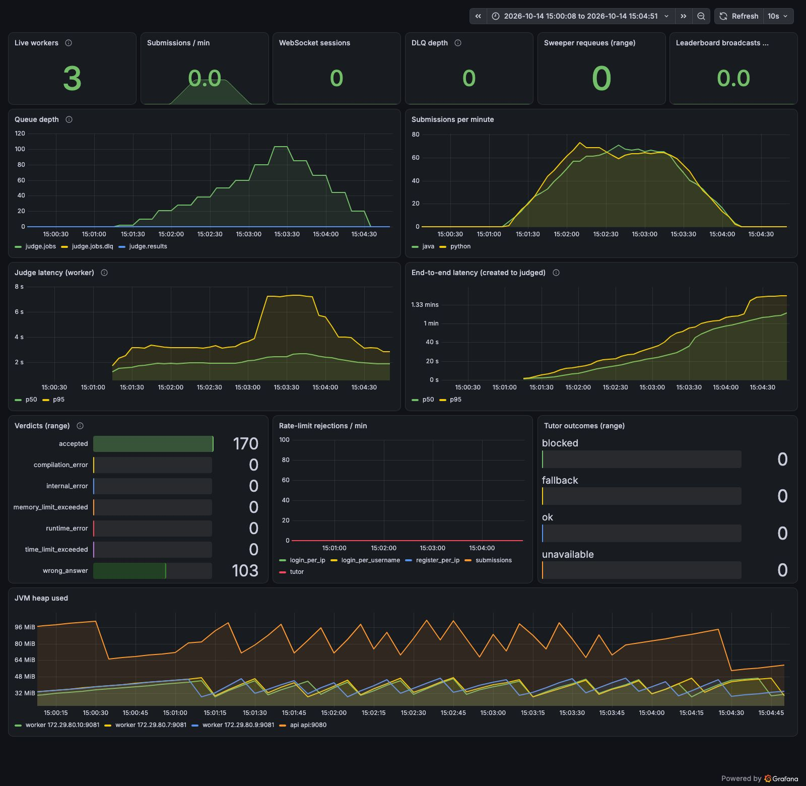

# Saturation rerun at 130 submissions/min, 3 workers (more pre-allocated VUs, 3 s polling)

Run `10140930` (saturation-130-rerun), 2026-10-14 09:31:10 UTC to 2026-10-14 09:33:46 UTC.

## Run conditions

- SentinelAI stopped, Colima 4 CPU / 6 GiB, on AC power.
- Host: Mac17,5 (Apple A18 Pro, 6 cores, 8 GB RAM), macOS, Colima 0.10.3 (vz), Docker 29.
- Workers: 3 (`WORKER_CONCURRENCY=1`, prefetch 1), api x1, everything in Docker Compose on the same VM as the sandboxes.
- **Rate limits raised** with `docker-compose.loadtest.yml` (all api limits set to 100000); k6 runs from one client IP and a few dozen users, so the real limits would block it.
- k6 v2.3.0 on the host, against the frontend container (`http://localhost:8080`). Scenario: ramping-arrival-rate at 130 submissions/min for 2 min (5 s ramp), 300 pre-allocated VUs (max 600) so k6 can offer the full rate, polling every 3 s (not 1 s) to reduce the api load from waiting VUs; 40 users; same 8-solution mix. Rerun of the 130/min step of saturation-3-workers.md, which offered only 116/min.
- Time to verdict is measured by k6 from just before `POST /api/submissions` until a `GET /api/submissions/{id}` poll (every 3000 ms) sees a final status, so it includes up to 3000 ms of polling granularity.

## k6

| Metric | Value |
|---|---|
| Submissions accepted by the api (201) | 270 |
| Submissions rejected | 0 |
| Submit success rate | 100.00% |
| HTTP requests (incl. polls) / failed rate | 3336 / 0.00% |
| Verdict timeouts (no final status within 10 min) | 0 |
| Verdict differed from the solution's expected verdict | 0 |
| Submit latency p50 / p95 (all) | 20 ms / 94 ms |
| Time to verdict p50 / p95 (all) | 21,077 ms / 60,271 ms |

## Throughput and server-side latency

Created and judged per minute come from `submissions.created_at` / `judged_at` in Postgres for this run's users. Judge and end-to-end percentiles are `histogram_quantile` over the window from the Prometheus histograms (bucket boundaries limit their precision). Queue depth is ready messages in `judge.jobs`, sampled every 15 s.

| Window | Minutes | k6 time to verdict p50 / p95 | Created/min | Judged/min | Judge p50 / p95 | End-to-end p50 / p95 | Queue start / end / max |
|---|---|---|---|---|---|---|---|
| 130/min offered | 2.0 | 21,077 ms / 60,271 ms | 130.0 | 78.5 | 2,079 ms / 4,205 ms | 17,001 ms / 39,514 ms | 2 / 80 / 80 |
| whole run | 2.6 | | 104.0 | 77.8 | 2,120 ms / 4,161 ms | 19,747 ms / 57,891 ms | 2 / 85 / 103 |

Queue depth over time (`judge.jobs`, every 30 s from the run start):

```
0s=0 30s=10 60s=28 90s=50 120s=80 150s=85 180s=44 210s=0 240s=0
```

## Resources (mean / max over the run, 31 samples)

VM CPU is the whole Docker VM from `/proc/stat` (4 vCPU = 100%), split into user and system (kernel) time. Process CPU is from `top` inside the VM in % of one core; it misses processes shorter than its 1 s interval, which includes most sandbox runs. Container CPU is `docker stats` (% of one core).

| Measure | Mean | Max |
|---|---|---|
| VM CPU busy | 77% | 89% |
| VM CPU user | 49% | 56% |
| VM CPU system (kernel) | 27% | 34% |
| VM CPU iowait | 3% | 4% |
| Sandbox containers alive | 1 | 3 |
| top: java | 27% | 63% |
| top: python | 1% | 15% |
| top: dockerd | 33% | 44% |
| top: containerd | 45% | 62% |
| top: runc | 0% | 2% |
| top: postgres | 2% | 5% |
| top: rabbitmq | 4% | 30% |
| docker stats CPU: api | 16% | 99% |
| docker stats CPU: worker | 15% | 35% |
| docker stats CPU: postgres | 2% | 7% |
| docker stats CPU: rabbitmq | 8% | 71% |
| memory: api | 523 MiB | 524 MiB |
| memory: worker | 885 MiB | 886 MiB |

## Correctness checks

| Check | Result |
|---|---|
| Submissions in the database for this run | 270 |
| Still PENDING / RUNNING after drain | 0 |
| INTERNAL_ERROR | 0 |
| Finalized exactly once (one `Submission N judged` api log line each) | 270 of 270 |
| Duplicate results ignored by the api (`already final`) | 0 |
| Submissions judged more than once by workers (extra judgings) | 0 (0) |
| Prometheus verdict counter deltas equal database counts | yes |

Verdicts (database):

| Language | Verdict | Database | Prometheus delta |
|---|---|---|---|
| java | accepted | 63 | 63 |
| java | wrong_answer | 69 | 69 |
| python | accepted | 105 | 105 |
| python | wrong_answer | 33 | 33 |

All checks passed.



## Compared with the 130/min step of `saturation-3-workers.md` (original numbers kept there)

| | Original 130/min step | This rerun |
|---|---|---|
| Created/min (offered) | 116.0 (k6 dropped iterations: 122 over the whole run) | 130.0 (0 dropped) |
| Polling interval | 1 s | 3 s |
| Judged/min | 81.0 | 78.5 |
| Judge p50 / p95 | 2,147 / 3,591 ms | 2,079 / 4,205 ms |
| Queue during the step | 15 to 77 | 2 to 80 |

With the full rate offered and a third of the polling load, judged throughput stayed at about 80/min and the queue
grew by about 40 per minute. The drop below the 97.5/min of the 100/min step is therefore not a polling artifact;
3 workers on this 4-vCPU VM sustain roughly 80 judged/min under a permanent backlog.
