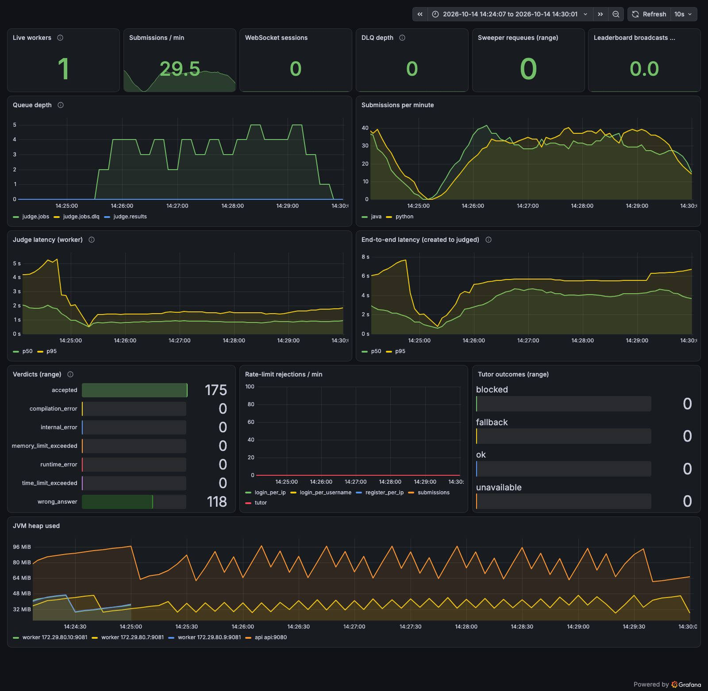

# Submissions, 1 worker (closed model, 6 VUs)

Run `10140854` (submissions-1-worker), 2026-10-14 08:55:08 UTC to 2026-10-14 08:59:39 UTC.

## Run conditions

- SentinelAI stopped, Colima 4 CPU / 6 GiB, on AC power.
- Host: Mac17,5 (Apple A18 Pro, 6 cores, 8 GB RAM), macOS, Colima 0.10.3 (vz), Docker 29.
- Workers: 1 (`WORKER_CONCURRENCY=1`, prefetch 1), api x1, everything in Docker Compose on the same VM as the sandboxes.
- **Rate limits raised** with `docker-compose.loadtest.yml` (all api limits set to 100000); k6 runs from one client IP and a few dozen users, so the real limits would block it.
- k6 v2.3.0 on the host, against the frontend container (`http://localhost:8080`). Scenario: ramping VUs 0 to 6 over 30 s, 6 VUs to 1 min (warm-up), 6 VUs for 3 min (steady state), ramp-down 30 s; 1 s think time after each verdict; 12 users; solutions picked uniformly from 8 (5 accepted, 3 wrong answer; Java and Python) on two-sum, fizzbuzz and reverse-string.
- Time to verdict is measured by k6 from just before `POST /api/submissions` until a `GET /api/submissions/{id}` poll (every 250 ms) sees a final status, so it includes up to 250 ms of polling granularity.

## k6

| Metric | Value |
|---|---|
| Submissions accepted by the api (201) | 286 |
| Submissions rejected | 0 |
| Submit success rate | 100.00% |
| HTTP requests (incl. polls) / failed rate | 5150 / 0.00% |
| Verdict timeouts (no final status within 10 min) | 0 |
| Verdict differed from the solution's expected verdict | 0 |
| Submit latency p50 / p95 (all) | 7 ms / 18 ms |
| Time to verdict p50 / p95 (all) | 4,318 ms / 5,779 ms |
| Submit latency p50 / p95 (steady state) | 7 ms / 16 ms |
| Time to verdict p50 / p95 (steady state) | 4,343 ms / 5,854 ms |

## Throughput and server-side latency

Created and judged per minute come from `submissions.created_at` / `judged_at` in Postgres for this run's users. Judge and end-to-end percentiles are `histogram_quantile` over the window from the Prometheus histograms (bucket boundaries limit their precision). Queue depth is ready messages in `judge.jobs`, sampled every 15 s.

| Window | Minutes | Created/min | Judged/min | Judge p50 / p95 | End-to-end p50 / p95 | Queue start / end / max |
|---|---|---|---|---|---|---|
| steady state | 3.0 | 66.7 | 66.3 | 878 ms / 1,573 ms | 4,284 ms / 5,609 ms | 3 / 5 / 5 |
| whole run | 4.5 | 63.3 | 63.3 | 874 ms / 1,581 ms | 4,068 ms / 5,632 ms | 0 / 1 / 5 |

Queue depth over time (`judge.jobs`, every 30 s from the run start):

```
0s=0 29s=2 59s=4 89s=4 119s=4 149s=4 179s=4 209s=4 239s=5 269s=1 299s=0
```

## Resources (mean / max over the steady state, 36 samples)

VM CPU is the whole Docker VM from `/proc/stat` (4 vCPU = 100%), split into user and system (kernel) time. Process CPU is from `top` inside the VM in % of one core; it misses processes shorter than its 1 s interval, which includes most sandbox runs. Container CPU is `docker stats` (% of one core).

| Measure | Mean | Max |
|---|---|---|
| VM CPU busy | 37% | 40% |
| VM CPU user | 23% | 26% |
| VM CPU system (kernel) | 14% | 15% |
| VM CPU iowait | 3% | 3% |
| Sandbox containers alive | 0 | 1 |
| top: java | 10% | 19% |
| top: python | 0% | 7% |
| top: dockerd | 18% | 24% |
| top: containerd | 24% | 31% |
| top: runc | 0% | 0% |
| top: postgres | 1% | 4% |
| top: rabbitmq | 2% | 31% |
| docker stats CPU: api | 4% | 9% |
| docker stats CPU: worker | 3% | 10% |
| docker stats CPU: postgres | 2% | 6% |
| docker stats CPU: rabbitmq | 7% | 56% |
| memory: api | 505 MiB | 505 MiB |
| memory: worker | 303 MiB | 304 MiB |

## Correctness checks

| Check | Result |
|---|---|
| Submissions in the database for this run | 286 |
| Still PENDING / RUNNING after drain | 0 |
| INTERNAL_ERROR | 0 |
| Finalized exactly once (one `Submission N judged` api log line each) | 286 of 286 |
| Duplicate results ignored by the api (`already final`) | 0 |
| Submissions judged more than once by workers (extra judgings) | 0 (0) |
| Prometheus verdict counter deltas equal database counts | yes |

Verdicts (database):

| Language | Verdict | Database | Prometheus delta |
|---|---|---|---|
| java | accepted | 56 | 56 |
| java | wrong_answer | 86 | 86 |
| python | accepted | 114 | 114 |
| python | wrong_answer | 30 | 30 |

All checks passed.


