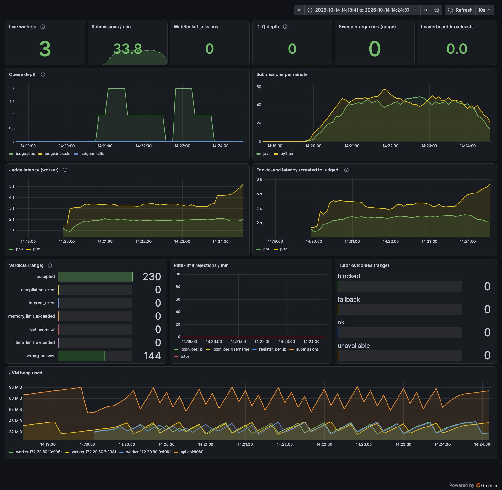

# Submissions, 3 workers (closed model, 6 VUs)

Run `10140849` (submissions-3-workers), 2026-10-14 08:49:42 UTC to 2026-10-14 08:54:13 UTC.

## Run conditions

- SentinelAI stopped, Colima 4 CPU / 6 GiB, on AC power.
- Host: Mac17,5 (Apple A18 Pro, 6 cores, 8 GB RAM), macOS, Colima 0.10.3 (vz), Docker 29.
- Workers: 3 (`WORKER_CONCURRENCY=1`, prefetch 1), api x1, everything in Docker Compose on the same VM as the sandboxes.
- **Rate limits raised** with `docker-compose.loadtest.yml` (all api limits set to 100000); k6 runs from one client IP and a few dozen users, so the real limits would block it.
- k6 v2.3.0 on the host, against the frontend container (`http://localhost:8080`). Scenario: ramping VUs 0 to 6 over 30 s, 6 VUs to 1 min (warm-up), 6 VUs for 3 min (steady state), ramp-down 30 s; 1 s think time after each verdict; 12 users; solutions picked uniformly from 8 (5 accepted, 3 wrong answer; Java and Python) on two-sum, fizzbuzz and reverse-string.
- Time to verdict is measured by k6 from just before `POST /api/submissions` until a `GET /api/submissions/{id}` poll (every 250 ms) sees a final status, so it includes up to 250 ms of polling granularity.

## k6

| Metric | Value |
|---|---|
| Submissions accepted by the api (201) | 368 |
| Submissions rejected | 0 |
| Submit success rate | 100.00% |
| HTTP requests (incl. polls) / failed rate | 4875 / 0.00% |
| Verdict timeouts (no final status within 10 min) | 0 |
| Verdict differed from the solution's expected verdict | 0 |
| Submit latency p50 / p95 (all) | 19 ms / 58 ms |
| Time to verdict p50 / p95 (all) | 2,872 ms / 4,914 ms |
| Submit latency p50 / p95 (steady state) | 19 ms / 53 ms |
| Time to verdict p50 / p95 (steady state) | 2,888 ms / 4,604 ms |

## Throughput and server-side latency

Created and judged per minute come from `submissions.created_at` / `judged_at` in Postgres for this run's users. Judge and end-to-end percentiles are `histogram_quantile` over the window from the Prometheus histograms (bucket boundaries limit their precision). Queue depth is ready messages in `judge.jobs`, sampled every 15 s.

| Window | Minutes | Created/min | Judged/min | Judge p50 / p95 | End-to-end p50 / p95 | Queue start / end / max |
|---|---|---|---|---|---|---|
| steady state | 3.0 | 90.0 | 90.3 | 1,938 ms / 3,244 ms | 2,830 ms / 4,260 ms | 1 / 1 / 2 |
| whole run | 4.5 | 81.3 | 81.3 | 1,934 ms / 3,391 ms | 2,784 ms / 4,868 ms | 0 / 0 / 2 |

Queue depth over time (`judge.jobs`, every 30 s from the run start):

```
0s=0 29s=0 59s=0 89s=2 119s=1 149s=1 179s=0 209s=2 239s=1 269s=0 299s=0
```

## Resources (mean / max over the steady state, 36 samples)

VM CPU is the whole Docker VM from `/proc/stat` (4 vCPU = 100%), split into user and system (kernel) time. Process CPU is from `top` inside the VM in % of one core; it misses processes shorter than its 1 s interval, which includes most sandbox runs. Container CPU is `docker stats` (% of one core).

| Measure | Mean | Max |
|---|---|---|
| VM CPU busy | 78% | 82% |
| VM CPU user | 51% | 54% |
| VM CPU system (kernel) | 26% | 28% |
| VM CPU iowait | 3% | 4% |
| Sandbox containers alive | 1 | 2 |
| top: java | 26% | 65% |
| top: python | 1% | 16% |
| top: dockerd | 33% | 46% |
| top: containerd | 46% | 61% |
| top: runc | 0% | 1% |
| top: postgres | 2% | 5% |
| top: rabbitmq | 5% | 54% |
| docker stats CPU: api | 12% | 38% |
| docker stats CPU: worker | 25% | 47% |
| docker stats CPU: postgres | 3% | 22% |
| docker stats CPU: rabbitmq | 9% | 61% |
| memory: api | 503 MiB | 504 MiB |
| memory: worker | 829 MiB | 842 MiB |

## Correctness checks

| Check | Result |
|---|---|
| Submissions in the database for this run | 368 |
| Still PENDING / RUNNING after drain | 0 |
| INTERNAL_ERROR | 0 |
| Finalized exactly once (one `Submission N judged` api log line each) | 368 of 368 |
| Duplicate results ignored by the api (`already final`) | 0 |
| Submissions judged more than once by workers (extra judgings) | 0 (0) |
| Prometheus verdict counter deltas equal database counts | yes |

Verdicts (database):

| Language | Verdict | Database | Prometheus delta |
|---|---|---|---|
| java | accepted | 83 | 83 |
| java | wrong_answer | 89 | 89 |
| python | accepted | 143 | 143 |
| python | wrong_answer | 53 | 53 |

All checks passed.


